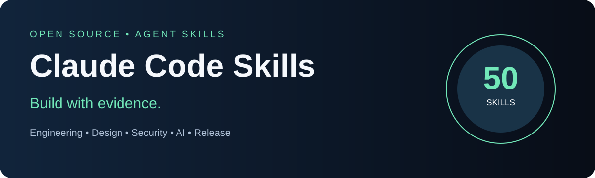

<p align="center"></p>

# Claude Code Skills

51 original, MIT-licensed Agent Skills for software development, debugging, security, UI/UX, SEO, languages, frameworks and AI engineering.

**Build with evidence, not unsupported completion claims.**

[Skills guide](SKILLS_GUIDE.md) · [Quick start](QUICKSTART.md) · [Workflows](WORKFLOWS.md) · [Contributing](CONTRIBUTING.md)

## Installation

```bash
git clone https://github.com/MDYUS/claude-code-skills.git
cd claude-code-skills
python3 scripts/install.py --project /path/to/project
```

Select individual skills with `--skills debugging anti-slop ship`. Preview with `--dry-run`. The installer copies entire skill directories, including reference files, without replacing existing skills.

## Featured skill: Website Forge

[/website-forge](skills/website-forge/SKILL.md) turns text briefs into complete websites and web applications with distinctive design, working features, technical SEO and browser verification. [Installation and examples](skills/website-forge/README.md).

## Skill catalog

### Quality

| Skill | Purpose |
|---|---|
| [/audit](skills/audit/SKILL.md) | Repository audit |
| [/debugging](skills/debugging/SKILL.md) | Root cause debugging |
| [/test](skills/test/SKILL.md) | Regression testing |
| [/code-review](skills/code-review/SKILL.md) | Code review |
| [/fix-all](skills/fix-all/SKILL.md) | Defect remediation |
| [/performance](skills/performance/SKILL.md) | Performance engineering |
| [/playwright-expert](skills/playwright-expert/SKILL.md) | Browser automation |

### Design

| Skill | Purpose |
|---|---|
| [/website-forge](skills/website-forge/SKILL.md) | Complete text-to-website development and anti-slop design |
| [/anti-slop](skills/anti-slop/SKILL.md) | UI design improvement |
| [/responsive](skills/responsive/SKILL.md) | Responsive design |
| [/accessibility](skills/accessibility/SKILL.md) | Accessible interfaces |
| [/forms](skills/forms/SKILL.md) | Robust forms |
| [/i18n](skills/i18n/SKILL.md) | Internationalization |

### Growth

| Skill | Purpose |
|---|---|
| [/seo](skills/seo/SKILL.md) | Technical SEO |
| [/content-check](skills/content-check/SKILL.md) | Content quality |

### Safety

| Skill | Purpose |
|---|---|
| [/security](skills/security/SKILL.md) | Defensive security |
| [/privacy](skills/privacy/SKILL.md) | Privacy engineering |
| [/dependency-review](skills/dependency-review/SKILL.md) | Dependency review |
| [/incident](skills/incident/SKILL.md) | Incident triage |

### Workflow

| Skill | Purpose |
|---|---|
| [/token-save](skills/token-save/SKILL.md) | Context efficiency |
| [/handoff](skills/handoff/SKILL.md) | Agent handoff |
| [/docs](skills/docs/SKILL.md) | Developer documentation |
| [/onboarding](skills/onboarding/SKILL.md) | Contributor onboarding |
| [/git-hygiene](skills/git-hygiene/SKILL.md) | Safe Git workflow |
| [/cost-review](skills/cost-review/SKILL.md) | Cost optimization |

### Engineering

| Skill | Purpose |
|---|---|
| [/api-contract](skills/api-contract/SKILL.md) | API contracts |
| [/database-migration](skills/database-migration/SKILL.md) | Schema migration |
| [/architecture](skills/architecture/SKILL.md) | System architecture |
| [/refactor](skills/refactor/SKILL.md) | Safe refactoring |
| [/observability](skills/observability/SKILL.md) | Observability |

### Release

| Skill | Purpose |
|---|---|
| [/deploy](skills/deploy/SKILL.md) | Deployment planning |
| [/ship](skills/ship/SKILL.md) | Release readiness |
| [/release-notes](skills/release-notes/SKILL.md) | Release notes |
| [/smoke-test](skills/smoke-test/SKILL.md) | Smoke testing |

### Languages

| Skill | Purpose |
|---|---|
| [/python-pro](skills/python-pro/SKILL.md) | Python development |
| [/typescript-pro](skills/typescript-pro/SKILL.md) | TypeScript development |
| [/javascript-pro](skills/javascript-pro/SKILL.md) | JavaScript development |
| [/sql-pro](skills/sql-pro/SKILL.md) | SQL engineering |

### Frameworks

| Skill | Purpose |
|---|---|
| [/react-expert](skills/react-expert/SKILL.md) | React development |
| [/nextjs-expert](skills/nextjs-expert/SKILL.md) | Next.js development |
| [/angular-expert](skills/angular-expert/SKILL.md) | Angular development |
| [/vue-expert](skills/vue-expert/SKILL.md) | Vue development |
| [/fastapi-expert](skills/fastapi-expert/SKILL.md) | FastAPI development |
| [/django-expert](skills/django-expert/SKILL.md) | Django development |

### Infrastructure

| Skill | Purpose |
|---|---|
| [/postgres-expert](skills/postgres-expert/SKILL.md) | PostgreSQL engineering |
| [/docker-expert](skills/docker-expert/SKILL.md) | Container engineering |
| [/ci-cd](skills/ci-cd/SKILL.md) | Continuous integration |

### AI

| Skill | Purpose |
|---|---|
| [/mcp-developer](skills/mcp-developer/SKILL.md) | Model Context Protocol development |
| [/rag-engineer](skills/rag-engineer/SKILL.md) | Retrieval augmented generation |
| [/llm-evaluation](skills/llm-evaluation/SKILL.md) | LLM evaluation |
| [/prompt-engineering](skills/prompt-engineering/SKILL.md) | Prompt engineering |

## What each skill includes

Technical knowledge, decision rules, a focused workflow, reference checklist, verification protocol and evidence requirements. Skills do not grant permissions or increase the underlying model's intelligence.

## Documentation website

Serve locally with `python3 -m http.server 8000 --directory site`. Each skill has its own static HTML page with descriptive metadata and crawlable links. To deploy, enable GitHub Pages using GitHub Actions and run the provided Pages workflow, or publish the site directory on Netlify. The sitemap assumes the default GitHub Pages URL; update it and canonical URLs if using another domain.

## Validation

```bash
python3 scripts/validate.py
python3 -m unittest discover -s tests -v
```

The included checks cover structure and installation. Real agent benchmarks, marketplace installation and live deployment are not yet verified. Independent project, not affiliated with Anthropic.

[MIT License](LICENSE)